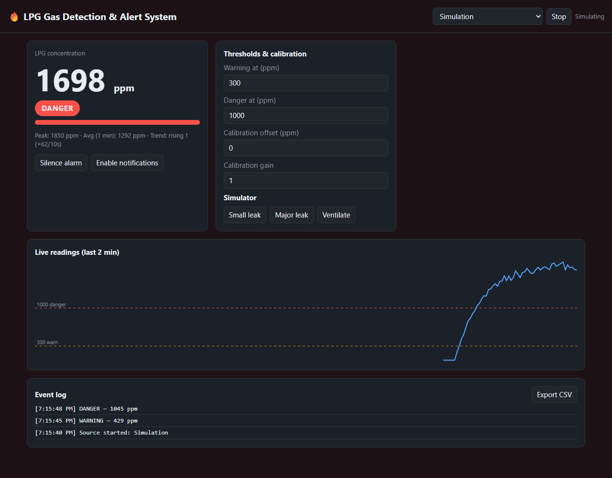
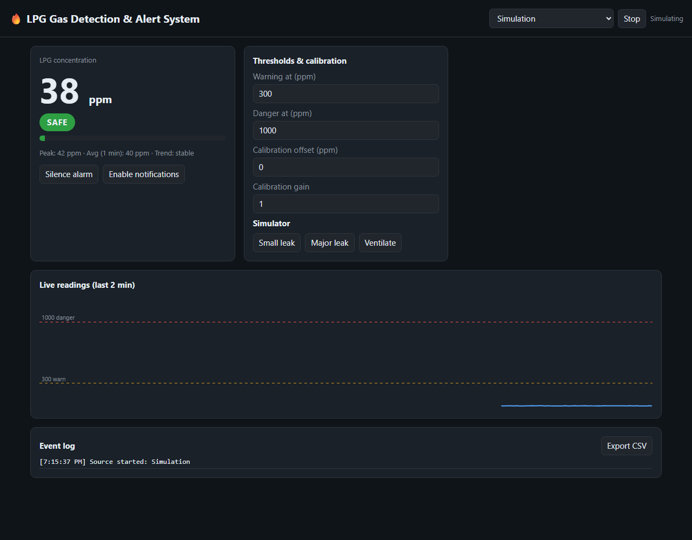
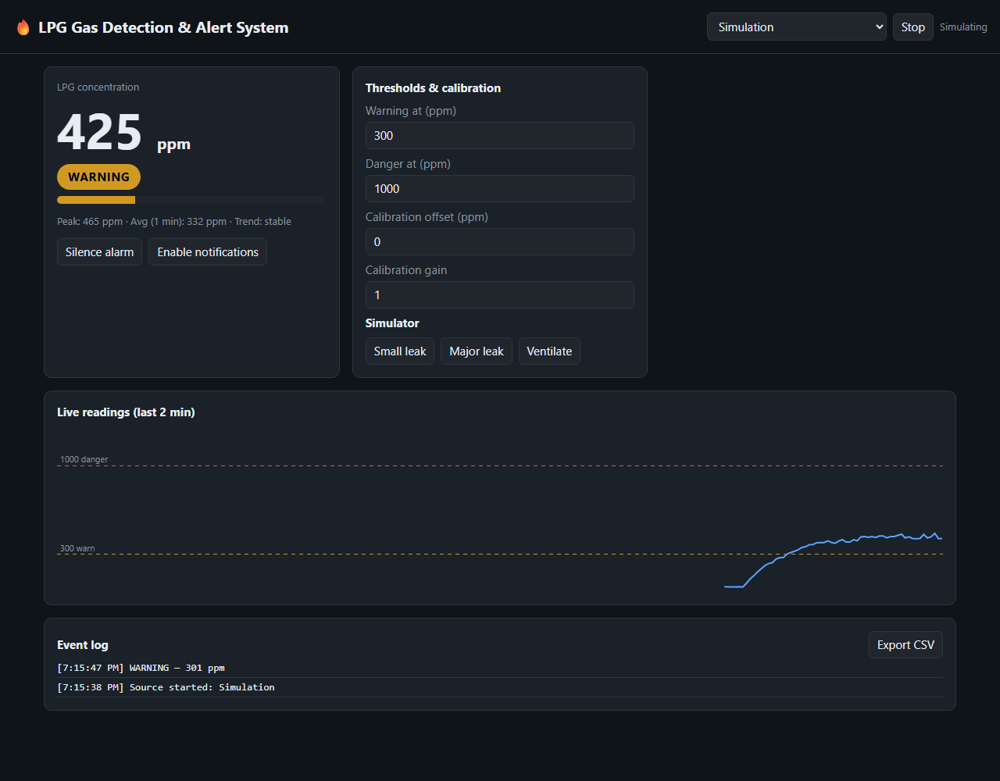

# LPG Gas Detection and Intelligent Alert System

**ESP8266 · MQ-2 / MQ-7 Sensors · AWS (API Gateway, Lambda, SNS) · 2026**

A safety-critical IoT system that continuously monitors **LPG** and **carbon monoxide (CO)** levels, automatically shuts off the gas supply when a leak is detected, and sends instant SMS alerts.



## Highlights

- **Continuous gas monitoring:** MQ-2 (LPG / combustible gas) and MQ-7 (CO) sensors read by an ESP8266.
- **Serverless alert pipeline:** the ESP8266 fires HTTP triggers to **AWS API Gateway**, which invokes an **AWS Lambda** function for threshold analysis.
- **Automatic shut-off:** a relay-driven **solenoid valve** cuts the gas line when a dangerous level is detected.
- **Instant SMS alerts:** Lambda publishes to **Amazon SNS**, which sends SMS to registered phone numbers.
- **Live web dashboard:** real-time readings from hardware (USB serial or WiFi), plus a built-in simulator for demos and testing.

## Architecture

```
 ┌──────────────┐   analog   ┌──────────────┐  HTTPS POST   ┌─────────────────┐
 │ MQ-2 (LPG)   ├───────────►│              ├──────────────►│ AWS API Gateway │
 │ MQ-7 (CO)    │            │   ESP8266    │               └────────┬────────┘
 └──────────────┘            │  (NodeMCU)   │                        ▼
                             │              │               ┌─────────────────┐
 ┌──────────────┐   GPIO     │              │               │   AWS Lambda    │
 │ Relay +      │◄───────────┤              │               │ threshold check │
 │ Solenoid     │            └──────┬───────┘               └────────┬────────┘
 │ valve        │                   │ Serial / WebSocket             ▼
 └──────────────┘                   ▼                         ┌─────────────────┐
                             ┌──────────────┐                 │   Amazon SNS    │──► SMS
                             │ Web dashboard│                 └─────────────────┘
                             └──────────────┘
```

## Alert levels

| Level   | Default threshold | Action |
|---------|-------------------|--------|
| SAFE    | < 300 ppm         | Normal monitoring |
| WARNING | ≥ 300 ppm         | Slow audible beep, dashboard + browser notification |
| DANGER  | ≥ 1000 ppm        | Fast alarm, flashing UI, valve shut-off, SMS via SNS |

You can change the thresholds in the dashboard to match your sensor calibration.

## Web dashboard

| Safe | Warning | Danger |
|------|---------|--------|
|  |  |  |

Features:
- **Three data sources:** Simulation, Hardware via USB (Web Serial), Hardware via WiFi (WebSocket).
- Live ppm reading, peak, 1-minute average and rising/falling trend.
- 2-minute live chart with warning and danger threshold lines.
- Audible alarm (Web Audio), flashing UI and desktop notifications.
- Calibration offset and gain controls.
- Event log with CSV export.

### Run it

There's nothing to install. Open `index.html` in **Chrome or Edge**. USB serial mode needs the Web Serial API, which these browsers support.

1. Pick a data source in the top-right dropdown.
2. Click **Start**.
3. In Simulation mode, use **Small leak**, **Major leak** and **Ventilate** to drive the readings.

### Hardware data format

The dashboard accepts one reading per line at **9600 baud** (serial) or per WebSocket message, in any of these forms:

```
523
ppm:523
{"ppm":523}
```

## Hardware

| Component | Purpose |
|-----------|---------|
| ESP8266 (NodeMCU) | Microcontroller + WiFi |
| MQ-2 | LPG / combustible gas sensor |
| MQ-7 | Carbon monoxide sensor |
| 5V relay module | Drives the solenoid valve |
| 12V solenoid valve (normally open) | Gas line shut-off |
| Buzzer | Local audible alarm |

> The ESP8266 has a single analog input (A0). To read both MQ sensors, use an analog multiplexer (e.g. CD4051) or an external ADC (e.g. ADS1115).

`lpg_sensor/lpg_sensor.ino` is a reference sketch for reading an MQ-series sensor, converting it to ppm, sounding a local buzzer and streaming `{"ppm":N}` lines to the dashboard. It calibrates R0 in clean air at startup. Tune the curve constants `A` and `B` for your module.

## Repository structure

```
.
├── index.html                 # Web dashboard (simulation + live hardware)
├── lpg_sensor/
│   └── lpg_sensor.ino         # Sensor reference sketch
└── docs/screenshots/          # README images
```

## Safety notice

This is an educational / prototype project. It is not a certified gas safety device and must not replace a certified commercial LPG or CO detector. If you smell gas: don't operate switches or flames, open windows, shut the main valve and leave the area.
